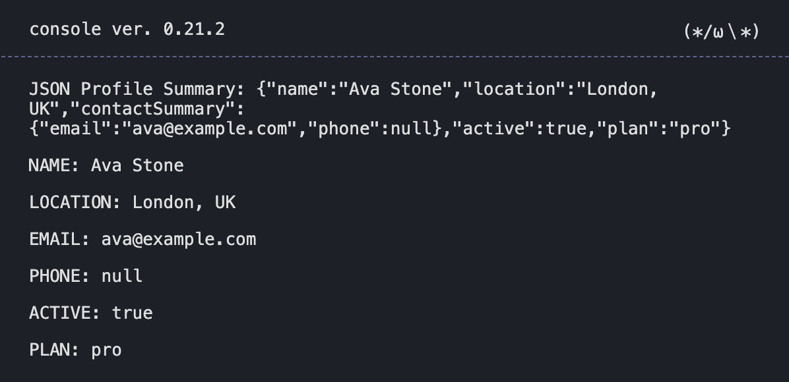

JS, JSON User profile helper - roadmap.sh project

Formats a nested user object into values that are more intuitive for UI or API usage (JS roadmaap.sh project)

### notes
Originally this challenge required building a few helper functions that return specific user data, eg. getDisplayName() or isAccountActive(). After completing this I added a section which demonstrates how the helper functions can actually be used in a real world example by displaying a user summary.

### improvements
- The original data could be sourced from an API using fetch() and async/await
- Small formatting or UI improvements to make the data more visually appealing and easy to scan.

### preview
